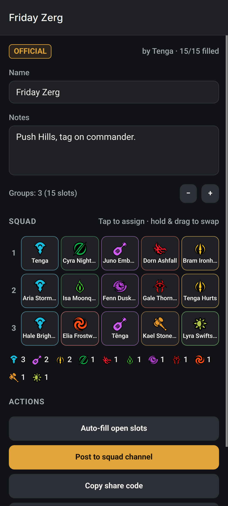
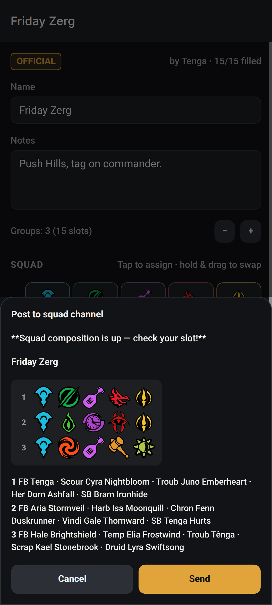
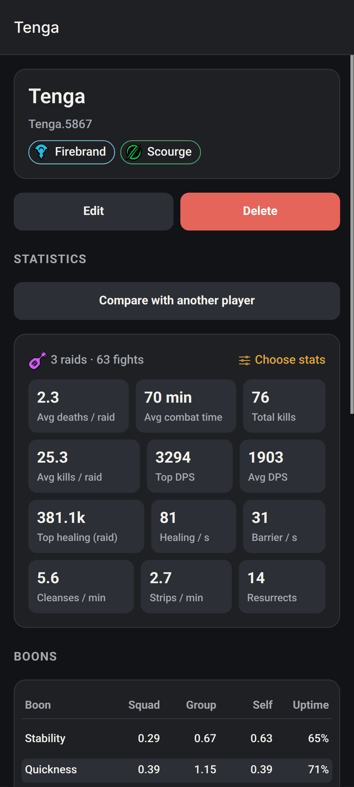

# GW2 Raid Planner

A free squad planner for Guild Wars 2 WvW guilds. Build your raid squads, keep your roster, track raid days, post squads to Discord, and follow your players' stats from arcdps logs.

**Android:** download the latest `.apk` from [Releases](../../releases/latest) and open it on your phone. You need to allow installing apps from your browser or file manager.
**iPhone:** open https://gw2-raidplanner.expo.app in Safari → Share → *Add to Home Screen*.

  
  
  

## Features

### Squads
- Plan squads of up to **50 players: 10 groups of 5**, shown top to bottom.
- All **9 professions with all 5 specializations**, including the Visions of Eternity elites.
- **Tap** a slot to pick a class and player, or **drag and drop** to swap slots. Dragging works with a finger or a mouse.
- **Auto-fill** open slots from members who play that spec.
- Spec counts under the squad show at a glance how many Firebrands, Scourges and so on you have.
- **Official squads** are made by leaders. **Test squads** can be made by anyone to try out ideas and show them to the guild. A leader can promote a test squad to official.
- **Role colors:** give any slot a role and its icon is recolored the way most guilds do it: **red = power**, **green = condi**, **blue = support**. Slots without a role keep the normal class colors. This shows what a spec is supposed to play, for example a support Chronomancer versus a power Chronomancer.
- **Share squad** sends a picture of the squad (name, raid time, notes, groups with icons and names) through your phone's normal share menu: WhatsApp, the Discord app, Messenger, or save it to your photos.
- Share squads as a short **text code** that others can import.

### Discord posting with class icons
- Post a squad straight to your Discord channel through a **webhook**.
- The post starts with an **image of the squad made from the class icons**, one row per group. Below it is the **group list with player names**, for example `1 FB Tenga · Scour … · Troub …`.
- Empty groups are left out of the image.
- A preview shows exactly what will be posted before you press Send.
- There are separate webhooks for the **official squad channel** and a **discussion channel** for test squads.
- Raids on the calendar can be announced on Discord with their squad attached.
- When roles are used, the post shows a color key, and the name list marks each player's role (🟥 power, 🟩 condi, 🟦 support).

### Members
- Add, edit and delete members. Each member can have **several classes and specs**.
- **Import a member list** by pasting it or loading a `.txt` file, one member per line. Lines like `Name.1234` are saved as GW2 accounts, which is how logs are matched to players.
- Set a member's **GW2 account** by typing `Name.1234`, or paste a **GW2 API key** and the app fills in the account name for you. The key is only used once and is never saved.
- Search by name and filter by profession.

### Stats from arcdps logs
Import your WvW logs. The app **attaches the stats to the right player automatically** by GW2 account name, so every member's page shows their own numbers.

- **Supported sources:**
  - **dps.report** links
  - **Elite Insights** `.json` files
  - **TopStats** reports (TiddlyWiki `.html` and the "WvW Insights" pages)
  - **ARCBridge / AxiBridge** report links
  - Raw `.zevtc` files must be uploaded to dps.report first.
- **Per player stats:**
  - average deaths per raid
  - average combat time
  - kills and average kills per raid
  - top and average DPS
  - top healing, healing and barrier per second
  - cleanses and boon strips per minute
  - resurrects
- **All 12 boons** for every player:
  - boon output to the **squad**, their **group** and **themselves**
  - their **uptime** (average stacks for Might)
- **Raid history:** every imported raid is listed on the player's page.
- **Leaderboard** for each stat, either for **one raid day** or as an **all raids** summary, with an option to show only roster members.
- **Compare two players** side by side. The better value is highlighted.
- **Choose stats** lets you show only the numbers you care about.

### Calendar and reminders
- Plan raid days with a start time, duration and the squad that runs.
- Get a **phone notification 15, 30 or 60 minutes before** the raid starts. This works in the Android app only.

### Roles and sharing
- **Leaders** edit official squads, the roster and raids. **Members** view them and make their own test squads.
- Leader mode can be protected with a **PIN**.
- Leaders share the roster, squads and raids with the guild through **Settings → Export guild data**. Members import that export.

### Other
- Dark and light theme, or follow the phone's setting.

## Privacy
All data stays **on your own device**. Nothing is uploaded to a server. Discord webhook links are entered by each leader in Settings and are never part of the app. A guild-only Discord login is planned before any online sharing is added.

## Updating
New versions install over the old one and keep your data.

## Credits
Developed by **Tenga**. Shout out to **Buka, Ka, QWOP and RIP BiG**.

- [arcdps](https://www.deltaconnected.com/arcdps/) by **deltaconnected**, which records the combat logs.
- [dps.report](https://dps.report) and its **developers**, for hosting and parsing logs.
- **ArenaNet**, for Guild Wars 2, the GW2 API and the class icons.

Class and specialization icons are from the Guild Wars 2 Wiki. Guild Wars 2 © ArenaNet LLC. This is a free, fan-made, non-commercial tool, not affiliated with ArenaNet, NCSOFT, arcdps or dps.report.

*Screenshots use example names.*
